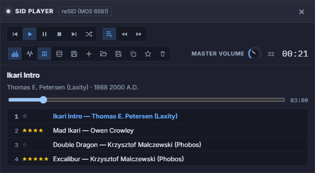
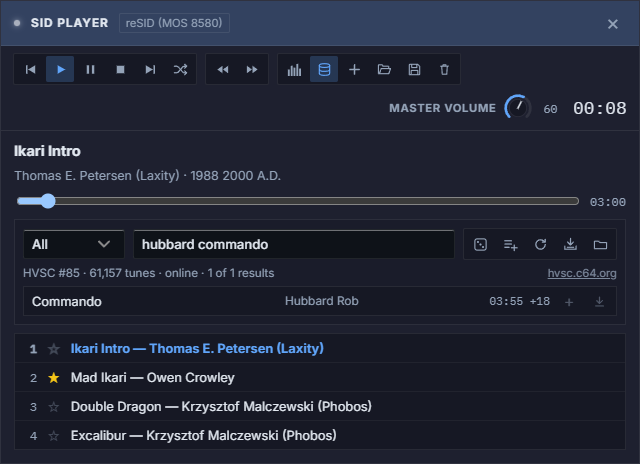
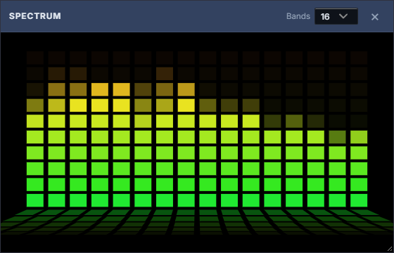
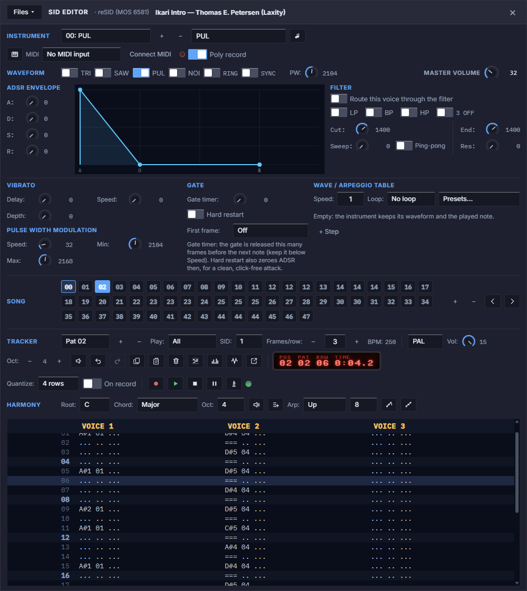
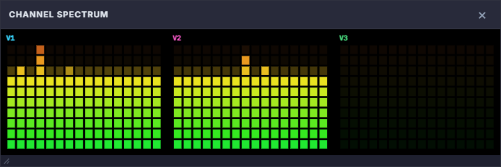
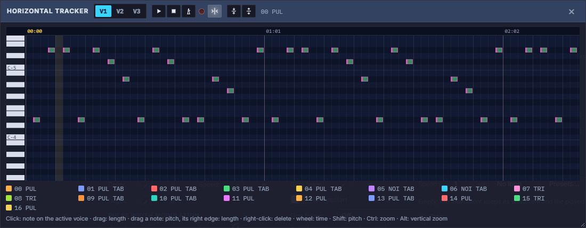
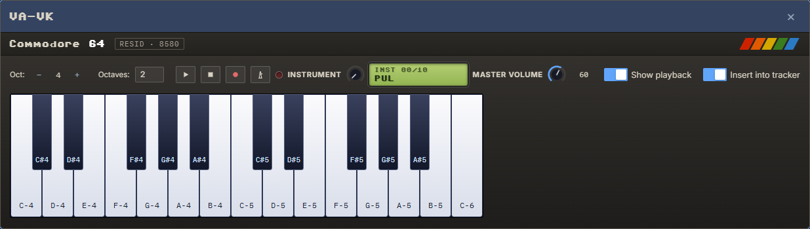
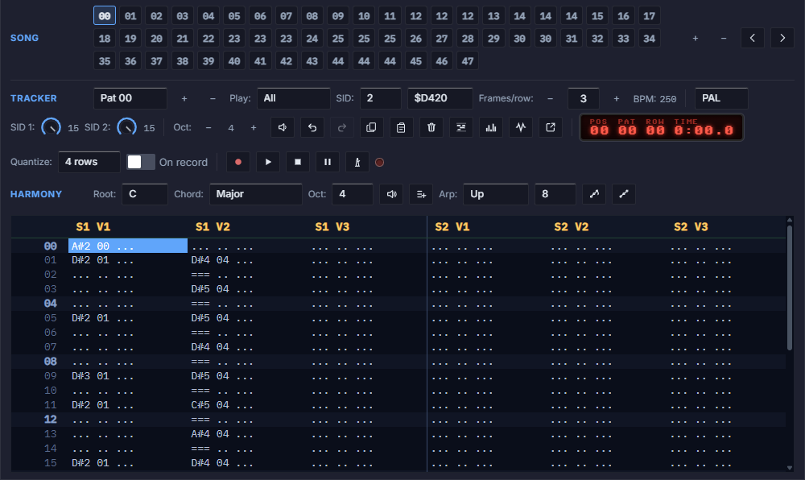
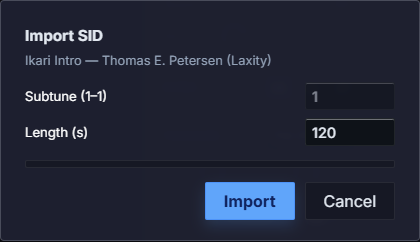
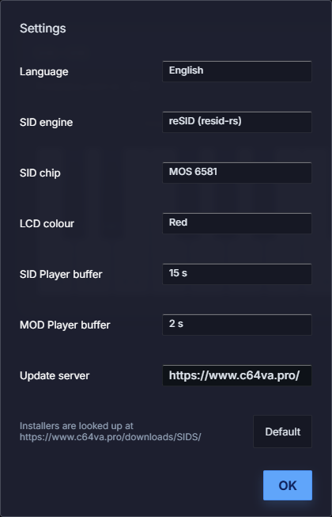

# VA SID Studio — User Manual

**Version 1.5.1**

VA SID Studio is a Commodore 64 SID music player and tracker for the desktop. It plays `.sid` files, including the whole High Voltage SID Collection, and Amiga and PC tracker modules, including the Modland collection, and lets you write tunes that run on a real C64. It is the SID part of [C64 Visual Assembler](https://www.c64va.pro/) as a standalone app.

---

## Table of Contents

- [1. Getting started](#1-getting-started)
- [2. SID Player](#2-sid-player)
- [3. High Voltage SID Collection](#3-high-voltage-sid-collection)
- [3b. Modland: Amiga and tracker modules](#3b-modland-amiga-and-tracker-modules)
- [4. Spectrum analyzer](#4-spectrum-analyzer)
- [5. SID Editor overview](#5-sid-editor-overview)
- [6. Instruments](#6-instruments)
- [7. Tracker](#7-tracker)
- [8. Song and patterns](#8-song-and-patterns)
- [9. Effects](#9-effects)
- [10. Playback and its displays](#10-playback-and-its-displays)
- [11. Horizontal tracker](#11-horizontal-tracker)
- [12. VA-VK, recording and MIDI](#12-va-vk-recording-and-midi)
- [13. Two SIDs](#13-two-sids)
- [14. Files, import and export](#14-files-import-and-export)
- [15. Using an exported tune on a C64](#15-using-an-exported-tune-on-a-c64)
- [16. Settings](#16-settings)
- [17. Known limits](#17-known-limits)
- [18. Credits and license](#18-credits-and-license)

---

## 1. Getting started

Installers are available for Windows, macOS and Linux; `readme.txt` describes how to install on each system.

The app is an empty workspace with a toolbar of icon buttons. Everything else floats in the workspace in its own window, and windows can stay open side by side. Hover over a button to see its name.

| Button | What it does |
|---|---|
| **SID Player** | Opens or closes the [SID Player](#2-sid-player). |
| **SID Editor** | Opens or closes the [SID Editor](#5-sid-editor-overview). |
| **New tune** | Opens the SID Editor and starts an empty tune, after asking first. |
| **Toggle theme** | Chooses one of 8 themes: Light, Dark, OLED, Black, Commodore 77, Commodore Starlight, Commodore Beige and Commodore 64. In December a ninth is offered, Christmas; after that the app goes back to the theme you had before. |
| **Settings** | Opens the [Settings](#16-settings). |
| **Manual** | Opens this manual as a PDF, in your system's PDF viewer. |
| **Check for update** | Looks for a new version, and downloads and installs it if you agree. The app restarts afterwards. It also looks at every start; **Skip this version** stops the question, the button stays lit. |
| **About** | Shows the version, the links and the license. |
| **Donation** | The pink heart appears after 10 minutes in each app session. It opens the donation page on c64va.pro in your browser, where you can support development through PayPal. The timer starts again whenever you launch the app. |
| **Exit** | Saves the tune and the playlist, then closes the app. |

**To listen to a tune:** open the SID Player, press **+** and choose a `.sid` file, then click the tune in the list.

**To write a tune:** open the SID Editor, click a cell in the tracker and play notes on the computer keyboard (see [Tracker](#7-tracker)), then press **Play**.

**Your work is kept:** the tune in the editor is saved automatically every 5 seconds and when the editor closes, and it comes back at the next start. That copy lives in the app's local storage, and there is one of it. Use **Files → Save .bin…** for anything you want to keep, especially before reinstalling or clearing app data.

The app also remembers which windows were open, their positions, the playlist and your settings.

---

## 2. SID Player

The SID Player plays PSID and RSID files. The tunes run on a built-in C64 core with a cycle-exact 6510, so raster-IRQ, CIA-timed and digi tunes play with the timing of a real machine. Tunes for two or three SIDs (PSID v3 / v4) play in stereo: SID 1 left, SID 2 right, a third SID in the centre.

It also plays tracker modules: Protracker / Soundtracker `.mod`, OctaMED, Oktalyzer, Future Composer, Fasttracker 2 `.xm`, Screamtracker `.s3m`, Impulse Tracker `.it` and about 60 more formats, with [libopenmpt](https://lib.openmpt.org/). See [Modland](#3b-modland-amiga-and-tracker-modules) for the collection.

The badge next to the title shows the engine and the chip in use, for example *reSID (MOS 8580)*, or *libopenmpt 0.8.10* for a module. See [Settings](#16-settings) to change the SID engine.

The window is called **MOD Player** while a module plays (and, when nothing plays, while the Modland panel is open) and **SID Player** otherwise.

**Closing the window stops the music**, whether you use ×, Esc or the toolbar button.

### Toolbar

| Group | Buttons |
|---|---|
| Transport | Previous, Play, Pause, Stop, Next, Shuffle |
| Subtunes and seek | Play subtunes in sequence, Back 10 s, Forward 10 s |
| Tools | Spectrum analyzer, Normalize volume, HVSC, Modland, Add .sid files or modules, Open playlist, Save playlist, Clear playlist |
| Volume | **Master volume** knob, shared with the SID Editor |

### Playlist

- **Add tunes** with the **+** button or by dropping `.sid` files or modules on the window. A module is recognised by its extension (`.mod`, `.xm`, `.s3m`, `.it`, `.med`, `.okt`…) or by the Amiga prefix form (`mod.title`).
- **Click a tune** to play it. The × that appears when you hover over a row removes that tune.
- **☆ / ★** marks a favourite. It is kept in the saved state and in playlist files.
- **Save playlist** and **Open playlist** write and read a `.sidpl` file. The tunes are embedded in it, so the file stands on its own.
- **Modules in the saved state:** a module from Modland is remembered by its path and comes back from the cache; a module you dropped on the window is kept with its bytes as long as the app's storage has room for it.
- **Shuffle** plays the list in random order, and no tune repeats until every tune has played. **Previous** steps back along the random order.

### Position and subtunes

- Drag the **position bar** or use **Back / Forward 10 s** to seek. The skipped part runs silently, so a long jump can take a moment.
- A file with several songs shows **‹ 1 / 3 ›** next to its details, to step between subtunes.
- **Play subtunes in sequence:** the list-and-play button before **Back 10 s** enables automatic playback of the remaining songs inside the current file. It is on by default and highlighted when enabled; the app remembers your choice across restarts. Starting from the selected subtune, playback advances to the next subtune in numerical order, then to the next playlist file after the final subtune. This also works with a single SID file and with **Shuffle** enabled; shuffle chooses the next file after its remaining subtunes have played. Turn the button off to advance directly to the next playlist file instead. The manual **Next** button always skips to the next file.
- **When a tune ends:** automatic advancement uses the current subtune's HVSC length when available, or the module's known length. Without a known length it advances after 3 minutes. For a SID file, any remaining subtunes play first when **Play subtunes in sequence** is on. At the end of the playlist, with shuffle off, the final SID subtune keeps playing until you stop it; the last module stops at its end.
- **Modules with several songs** (some `.xm`, `.it` and game modules) show the same **‹ 1 / 3 ›** once the module has started.
- **Normalize volume** (the button after the spectrum analyzer) plays every tune, SID or module, at about the same loudness: it raises or lowers each one towards a common level, by at most 12 dB, and never so far that its loudest part would clip. A module is measured over its whole length when it opens. A SID tune is measured on its first two seconds before it starts (so it starts a moment later), then the level follows the tune slowly as it plays. The button can be switched while a tune plays.

---

## 3. High Voltage SID Collection

The **HVSC** button opens a search panel for the [High Voltage SID Collection](https://www.hvsc.c64.org/), about 61,000 C64 tunes.

- **Search:** type a title, composer or folder, for example `hubbard commando` or `games/s-z`. Every word has to match. **Enter** plays the first result.
- **Composer:** the list next to the search field switches from **All** to **Composer**, which searches composer names only (`hubbard`, `rob hubbard`, `galway`) and lists the tunes by composer. The name comes from the tune's folder under `MUSICIANS`, so a composer is found by the folder's name, which may be a handle (`laxity`). About 4,600 tunes in `GAMES` and `DEMOS` have no composer folder: **All** finds them by title or folder.
- **Results:** click a tune to play it. In its row, **+** adds it to the playlist and the download button saves the `.sid` file.
- **Random tunes** lists 25 random ones. **Add all results** adds up to 100 of the found tunes to the playlist.
- **Top 50** (the star) lists 50 popular C64 tunes, most popular first: the 25 most remixed SID files according to [Remix64](https://remix64.com/)'s statistics of 20 years of C64 remixes (Last Ninja 2, Last Ninja, Commando, Great Giana Sisters, Delta…), then the originals most often in Remix64's C64 remix charts. HVSC itself has no ratings.
- **Tune lengths:** HVSC knows the length of every subtune, so the position bar shows it and the playlist moves on at the right moment.

**Where the tunes come from:** the catalog and single tunes are downloaded from an HVSC mirror on first use and kept in the app's cache, so a tune you have played once also plays offline. **Update catalog** fetches the newest list.

**Working offline:**

- **Download the whole collection…** downloads the official archive (about 85 MB) into a folder you pick and unpacks it there (about 380 MB). From then on the player uses that copy.
- **Use a local HVSC folder…** points the player at a collection you already have.

---

## 3b. Modland: Amiga and tracker modules

The **Modland** button (the floppy disk) opens a search panel for [Modland](https://ftp.modland.com/), the large archive of music modules. The panel lists only the formats the player can play: about 177,000 modules in 65 formats, among them Protracker, Soundtracker, OctaMED, Oktalyzer, Future Composer, Digibooster, Symphonie, Fasttracker 2, Screamtracker and Impulse Tracker. The HVSC and the Modland panel take turns: opening one closes the other.

- **Search:** type a title, composer or format, for example `lizardking`, `jesper kyd` or `octamed`. Every word has to match. **Enter** plays the first result.
- **Composer** and **Format** in the list next to the search field search only composer names or only the format (`protracker`, `future composer`, `fasttracker`). A composer is the module's folder in Modland, which may be a handle; a second name after `coop-` is shown with an `&`.
- **Results:** click a module to play it. Its row shows the composer (and the game or album, if Modland files it so), the format and the file size. **+** adds it to the playlist and the download button saves the file.
- **Random modules** lists 25 random ones. **Add all results** adds up to 50 of the found modules to the playlist.
- **Top 50** (the star) lists 50 popular Amiga tunes, most popular first: the originals most often in [Remix64](https://remix64.com/)'s Amiga remix charts, in a format the player plays (Echoing, Crystal Hammer, Lost Patrol, Rings of Medusa, Amegas, Guitar Slinger, The Chaos Engine…). Chart tunes in TFMX or other formats libopenmpt cannot play (Turrican 2, Amberstar, A Prehistoric Tale…) are left out.

**Where the modules come from:** the catalog (Modland's file list, about 6 MB) and single modules are downloaded from Modland on first use and kept in the app's cache, so a module you have played once also plays offline. **Update catalog** fetches the newest list.

Not every Modland format plays: the players of many Amiga formats (TFMX, Jochen Hippel, Sonic Arranger, AHX and others) are not in libopenmpt, so the panel leaves them out, together with the console and computer formats of other machines.

---

## 4. Spectrum analyzer

The **Spectrum analyzer** button opens a window with LED-style bars. It analyzes the sound that is playing, from the SID Player or the SID Editor. **Bands** sets 8, 16, 24 or 32 bands. The window can be moved and resized, and it closes and reopens together with the SID Player.

The SID Editor has a different, per-voice display: see [Channel spectrum](#channel-spectrum).

---

## 5. SID Editor overview

The SID Editor is a tracker with 3 voices, or 6 with a [second SID](#13-two-sids). From top to bottom:

| Area | Purpose |
|---|---|
| **Header** | **Files** menu, the engine in use, the tune's title. Drag it to move the window. |
| **Instrument, Waveform, ADSR, Filter, Vibrato, PWM, Gate, Table** | The [instrument](#6-instruments) being edited. |
| **Song** | The [order of patterns](#8-song-and-patterns) that make up the tune. |
| **Tracker** | Pattern selection, speed, octave, tools, the LCD and the transport buttons. |
| **Harmony** | [Chord and arpeggio](#harmony) helpers. |
| **Grid** | The [notes](#7-tracker) of the current pattern. |

Press **Esc** or × to close the editor. This stops playback and saves the tune for the next start.

**Detach tracker** moves the song, tracker, harmony and grid sections into a window of their own, so the instrument controls and the notes can sit side by side. **Attach tracker** puts them back.

---

## 6. Instruments

Each instrument holds a full sound setting. The list holds them in order, and the number in the list is the one you see in the tracker, in hexadecimal. **+** adds an instrument and **−** deletes the current one: the notes that play it switch to the instrument before it, after a question, and the later numbers move down. Files → **Delete unused instruments** removes every instrument no note plays. The field next to them names the current one. **Preview** plays it as an A-4 note.

Most values are set with knobs: drag them, or use the mouse wheel or the arrow keys.

### Waveform

- **TRI / SAW / PUL / NOI:** several waveforms can be on at once, and they combine as on the real SID.
- **RING:** ring modulation of the triangle by the previous voice (1 ← 3, 2 ← 1, 3 ← 2).
- **SYNC:** hard sync to the previous voice.
- **PW:** pulse width, 0–4095.

### ADSR envelope

Attack, decay, sustain and release, 0–15 each, with the SID's own rates. Set them with the knobs or by dragging the handles on the graph.

Sustain is also the effective volume of a single voice, because the SID has no per-voice volume.

### Filter

| Control | Purpose |
|---|---|
| **Route this voice through the filter** | Sends the voice to the filter. Choosing LP, BP or HP turns this on for you. |
| **LP / BP / HP** | Filter mode: low-pass, band-pass, high-pass. |
| **3 OFF** | Mutes voice 3 when it is not routed through the filter. |
| **Cut** | Cutoff, 0–2047. |
| **End, Sweep** | Moves the cutoff from Cut toward End, by Sweep (0–127) every frame. |
| **Ping-pong** | Makes the sweep bounce between Cut and End. |
| **Res** | Resonance, 0–15. |

The SID has one filter per chip, so it is shared: the voice that starts a filter-routed instrument sets it. The volume is the tune's, set by **Vol** in the tracker toolbar; an instrument has no volume of its own (use sustain for the level of one voice). Tunes saved before 1.3.3 take the first instrument's volume as the tune's.

### Vibrato

After **Delay** frames (0–255), a triangle LFO turns every **Speed** frames (0–15). **Depth** (0–15) is scaled to the note, so a setting sounds equally wide at any pitch. This is separate from the `V` [effect](#9-effects).

### Pulse width modulation

**Speed** (0–255) is added to the pulse width every frame, bouncing between **Min** and **Max**.

### Gate

- **Gate timer** (0–15) releases the gate that many frames before the next note on the voice. Keep it below the tune's Speed.
- **Hard restart** also zeroes ADSR at that moment, for a clean attack.
- **First frame** writes a chosen waveform on the note's first frame: `$09` test + gate, `$08` test, `$81` noise, `$41` pulse, `$21` saw or `$11` triangle.

### Wave / arpeggio table

A table of up to 32 steps runs during the note, and this is how arpeggios and drums are made. Each step has:

- a **waveform**, or — to keep the current one;
- a **note**: an offset in semitones, or **abs** for an absolute note.

**Speed** (1–15) is the number of frames per step. **Loop** jumps back to a chosen step at the end, or **No loop** stays on the last step. **+ Step** adds a step.

**Presets** fill the table:

| Group | Presets |
|---|---|
| Arpeggios | Major, minor, major 7, minor 7, dominant 7, sus4, diminished, augmented, power chord, octave, fast major, trill |
| Drums | Kick, snare, tom, clap, closed hi-hat, open hi-hat |
| Lead and bass | Three attack shapes |
| Sound effects | Laser, pickup, explosion |

A last entry clears the table.

---

## 7. Tracker

A pattern has 32 rows and one column per voice. A cell shows the note, the instrument (hexadecimal) and the effect, for example `C-4 01 V24`. Notes run from `C-0` to `B-7`.

An empty row holds the previous note: the gate stays on until the voice's next note or a note-off, as in other trackers.

### Entering notes

Click a cell, then play on the computer keyboard. The note goes into the cell with the current instrument, sounds, and the cursor moves to the next row.

| Keys | Notes |
|---|---|
| `Z S X D C V G B H N J M` | C, C#, D, D#, E, F, F#, G, G#, A, A#, B of the current octave |
| `Q 2 W 3 E R 5 T 6 Y 7 U` | C, C#, D, D#, E, F, F#, G, G#, A, A#, B of the next octave |
| `I` | C, two octaves above the current octave |

### Other keys

| Key | Action |
|---|---|
| Arrow keys | Move the cursor. Rows wrap around at the ends of the pattern. |
| **Shift** + Up / Down, **Shift** + click | Extend a rectangular selection. |
| **1**, `` ` `` or **=** | Note-off (`===`): releases the gate, so the instrument's release runs. |
| **Delete**, **Backspace** or **.** | Clears the cell and moves to the next row. |
| **Enter** or double-click | Edits the cell as text. |
| **+**, **\***, **Page Up** | Octave up. |
| **-**, **/**, **Page Down** | Octave down. |
| **Ctrl+C**, **Ctrl+V** | Copy and paste the selection. |

### Editing a cell as text

In a cell opened with **Enter**, type `note [instrument] [effect]`, then press **Enter** to save and go to the next row, or **Esc** to cancel. Instrument and effect values are hexadecimal.

| You type | Result |
|---|---|
| `C-4 01` | C-4 with instrument 01 |
| `C#5`, `Db4`, `c4` | A note, keeping the cell's instrument |
| `C-4 01 V24` | Note, instrument and vibrato effect |
| `C-4 V24` | Note and effect, keeping the cell's instrument |
| `F06` | Speed change on its own, with no note |
| `C` | Note cut on its own |
| `===` or `OFF` | Note-off |
| Nothing, or `...` | Clears the cell |

### Selection

Right-click a cell for **Copy**, **Cut**, **Paste** and **Clear**. Right-clicking inside a selection keeps it. The toolbar has **Copy**, **Paste** and **Clear** buttons too.

Pasting starts at the cursor and stops at the edges of the pattern; it does not wrap into the next column or row.

### Tracker toolbar

| Control | Purpose |
|---|---|
| **Pat**, **+**, **−** | Selects, adds or deletes a pattern. |
| **Play** | **All** plays the song, **Pattern** plays the current pattern. |
| **SID** | 1 or 2 chips: see [Two SIDs](#13-two-sids). |
| **Quantize**, **On record** | The grid, 2, 4, 8 or 16 rows. In the horizontal tracker, **Q** or its button moves the selected notes to the nearest grid row and keeps their lengths; with **On record** checked, the notes of a recording are quantized the same way when it stops. |
| **Undo**, **Redo** | Or Ctrl+Z and Ctrl+Y. They step through the changes of the notes, instruments, song and tempo and the loading of a tune, up to 100 steps. A knob's drag or a whole recording is one step, and the view jumps to the instrument and pattern that changed. Text fields keep their own Ctrl+Z. |
| **Frames/row**, **−**, **+** | 1–255, so a higher number is slower. |
| **PAL / NTSC** | The machine the tune is for. NTSC runs 60 frames a second on the NTSC clock: the preview, the BPM, the exported player's note table and the `.sid` header follow it. |
| **Vol** (**SID 1**, **SID 2**) | The tune's volume, 0–15: the SID's master volume, for all three voices together. A two-SID tune has a knob for each chip. |
| **BPM** | Shows the resulting tempo, with 4 rows per beat: 6 frames/row = 125 BPM on PAL, 150 on NTSC. |
| **Oct**, **−**, **+** | Octave for note entry. |
| **Preview row** | Plays the selected row on all voices. |
| **Copy, Paste, Clear** | Work on the selection. |
| **Horizontal tracker** | Opens the [horizontal tracker](#11-horizontal-tracker). |
| **Channel spectrum** | Opens the [per-voice display](#channel-spectrum). |
| **Detach tracker** | Moves the tracker into its own window. |
| **Record, Play, Stop, Pause, Metronome** | See [Playback](#10-playback-and-its-displays) and [Recording](#recording). |

### Harmony

Choose a **Root**, a **Chord** type and an **Oct**ave, with 16 chord types from Major to 7sus4.

- The speaker button previews the chord. **Add chord** writes it to the first three voices on the selected row, using the current instrument.
- **Arp** previews or inserts a run of 4, 8 or 16 notes from the same chord, going up, down or up and down. It goes into the selected voice from the selected row, and it stops at the end of the pattern.

---

## 8. Song and patterns

**Patterns** are a bank of reusable 32-row blocks, and there can be up to 256 of them. **The song** is the order they play in, up to 255 steps. A pattern can repeat, so the song can be much longer than the bank. In the screenshot of the editor, patterns 12 and 14 repeat this way.

| Control | Purpose |
|---|---|
| A step in the **Song** row | Selects the step and opens its pattern. The playing step is highlighted. |
| **+** | Inserts the open pattern after the selected step. |
| **−** | Removes the selected step. At least one step remains. |
| **‹ ›** | Move the selected step earlier or later. |
| **+** next to **Pat** | Creates a new, empty pattern. It does not change the song. |
| **−** next to **Pat** | Deletes the pattern, asking first if it holds anything. The steps that used it are removed and the others renumbered. |

The song plays in a loop. Playback and every export follow the song, not the order of the bank.

---

## 9. Effects

A cell can carry one effect next to its note. Effects act once per row, and they behave the same in the editor as in the exported player.

| Code | Effect | Value |
|---|---|---|
| `V` | Vibrato | Low nibble: depth. High nibble: how many rows each direction is held. |
| `U` | Slide up | Added to the frequency register on that row. |
| `D` | Slide down | Subtracted from the frequency register on that row. |
| `C` | Note cut | Releases the gate. The value is not used. A `C` with no note is shown as `===`. |
| `F` | Speed | New frames-per-row value, effective immediately. |

Notes on using them:

- `V` works only on the rows that carry it, so put it on consecutive rows. The pitch returns to normal on the first row without it.
- `U` and `D` add up: each row carrying the effect moves the pitch further, and the pitch stays there until the next note on that voice.

---

## 10. Playback and its displays

**Play**, **Pause** and **Stop** are in the tracker toolbar, in VA-VK and in the horizontal tracker. Everything you hear in the editor comes from the selected SID engine: a frame-exact model of the exported player sends its SID registers to the engine. A tune therefore sounds in the editor as it does when exported. Note previews are rendered before they sound, so they start a moment after the key press.

### LCD

The display in the tracker toolbar shows the song position (**POS**), pattern (**PAT**), row (**ROW**) and playing time (**TIME**), or the edit position when stopped. [Settings](#16-settings) make it green or red.

### Channel spectrum

A window with one 16-band display per voice. It is calculated from the SID registers being played (frequency, waveform, pulse width, approximated ADSR, filter and volume), not from the audio, because the output is one mix. For that reason ring modulation, sync and filter resonance do not show. It moves during tracker playback only, not for notes played from a keyboard.

### Metronome

**Metronome** clicks every 4 rows, with an accent on the first beat of each 4-beat bar. The lamp next to it flashes on every beat during playback and recording, even when the click is off.

---

## 11. Horizontal tracker

The horizontal tracker draws the whole song as notes over time and lets you edit it with the mouse. Time runs to the right and pitch upward. Each instrument has its own colour, listed under the display. It edits the same tune as the grid, so changes appear in both at once.

| Action | Result |
|---|---|
| Click on an empty place | New note on the active voice with the current instrument; drag to set its length |
| Drag a note | Moves it in time and pitch. It keeps its length, instrument and effect, and stops a row short of the voice's next note |
| **Shift**+drag | Selects the notes a frame touches; **Ctrl**+**Shift**+drag adds them to the selection |
| **Ctrl**+click a note | Adds it to the selection or takes it out; **Ctrl**+**A** selects all, **Esc** clears |
| **Ctrl**+**X** / **C** / **V**, **Del** | Cut, copy, paste and delete, also with the buttons in the header. A paste goes to the row under the mouse, or else to the tracker cursor, and writes over what is there |
| **Q** | Quantizes the selected notes on the grid set in the tracker toolbar |
| **Undo**, **Redo** in the header | The same as in the tracker toolbar, or Ctrl+Z and Ctrl+Y |
| Drag a note's right end | Stretches or shortens it, up to the voice's next note. Over the end the cursor is a double arrow and a bright bar marks it, on a one-row note as well |
| Right-click a note | Deletes it |
| Mouse wheel | Scrolls in time |
| **Shift** + wheel | Scrolls in pitch |
| **Ctrl** + wheel | Zooms in time |
| **Alt** + wheel | Zooms in pitch (also the two buttons in the header) |

**V1–V3** (to **V6** with two SIDs) choose the active voice. **Follow playback** keeps the playing position in view. The window has its own Play, Stop and Metronome buttons, and it can be moved and resized.

A note's end is a note-off in the tracker, and the notes of a repeated pattern are one and the same: changing one changes it wherever that pattern plays.

---

## 12. VA-VK, recording and MIDI

### VA-VK

The **Virtual keyboard** button opens VA-VK, a piano of 2, 3 or 4 octaves that plays the current instrument. Its position, octave and options are remembered.

| Control | Purpose |
|---|---|
| **Oct**, **Octaves** | First octave shown, and the number of octaves. |
| Play, Stop, Record, Metronome | Same as in the tracker toolbar. |
| **Instrument** knob | Selects the instrument, shown on the display next to it. |
| **Master volume** | Shared with the SID Player. |
| **Show playback** | Lights the keys of the notes that are playing. |
| **Insert into tracker** | Writes each played note at the tracker cursor and moves to the next row. Turn it off to play without editing. |

### Recording

**Record** (the red dot, in the tracker toolbar and on VA-VK) writes the notes you play, in time, into the selected voice from the selected row, at the current tempo. You can play on VA-VK, the computer keyboard or a MIDI keyboard. When the pattern is full, a new empty pattern is added after the current song step and recording goes on there. Press **Record** again to stop.

### MIDI

Press **Connect MIDI** next to the instrument name, then choose the input in the **MIDI** list. Notes play the current instrument, and they are written into the tracker while recording or with *Insert into tracker* on. The lamp flashes on every incoming message.

With **Poly record** on, the keys you hold while recording go to voices of their own, from the selected voice on: a chord of three lands on three voices. Releasing a key writes a note-off, and when every voice is held, the oldest key gives up its voice.

MIDI depends on the web view of your system. Where it is not available, the app says so when you press **Connect MIDI**.

---

## 13. Two SIDs

**SID: 2** in the tracker toolbar makes the tune six voices, headed **S1 V1** to **S2 V3**. The list next to it sets the second chip's address: `$D420`–`$D7E0` or `$DE00`–`$DFE0`, in steps of `$20`.

- Each SID has its own filter and volume, and a voice controls those of its own chip only.
- The chips play in stereo: SID 1 left, SID 2 right. Note previews play on the first SID.
- **SID: 1** deletes the second chip's voices, asking first if they hold anything.
- The tune needs a machine or an emulator with a second SID at the chosen address.

---

## 14. Files, import and export

| Files menu | What it does |
|---|---|
| **New tune** | Starts an empty tune, after asking first. |
| **Load .bin…** | Opens a tune saved by the editor, including older versions of the format. |
| **Save .bin…** | Saves the tune in the editor's own format, with everything in it. |
| **Delete unused instruments** | Removes every instrument no note plays, and renumbers the rest. |
| **Import GoatTracker .sng…** | Replaces the current tune with a GoatTracker 2 song. |
| **Import .sid…** | Turns a PSID / RSID file into an editable tune in place of the current one. |
| **Export asm** | Copies the complete 6502 source to the clipboard. |
| **Export to UltimateBasic** | Copies a `tune … end` block to the clipboard. |
| **Export .sid (PSID)…** | Saves a `.sid` file that plays in any SID player. |

**The two imports replace the current tune.** Save it first if you need it.

### Import .sid

Choose the subtune and the length in seconds (up to 900), and press **Import**. The tune runs silently, its SID registers are recorded frame by frame and turned into a song. This works from what the tune writes to the chip, so the result is an approximation that you can edit, not the composer's original data. When it finishes, a message lists what was approximated.

- **Notes:** a note starts at a gate edge, and a retrigger within 2 frames counts as one note. A pitch change under a held gate that stays at least 5 frames becomes a new note. NTSC tunes are retuned to the PAL note table.
- **Rows:** rows start exactly on the note starts. Rows one frame longer (funktempo, swing, tempo changes) are set with `F` effects.
- **Instruments:** AD / SR, waveform, pulse width and PWM, the filter, and the waveform and pitch of every frame of the note, as a wave table of up to 32 steps. A regular sub-semitone wobble becomes the instrument's vibrato. Identical instruments are shared, up to 128.
- **Filter and pulse movement:** a filter sweep counts over the whole note, also after the waveform went silent, and it ends where another note restarts the filter. A filter table that falls fast counts by when it gets there, within the player's 127 per frame. A filter LFO bounces between its extremes. An instrument holds the pulse range of all its notes. Pulse and filter still restart at each routed note, so a sweep that runs freely across many notes is only approximated, and pitches that lie between semitones are rounded to the nearest one.
- **Several SIDs:** a 2SID tune becomes six voices with its second address. A 3SID tune imports its first two SIDs, with a notice.
- **Not supported:** RSID tunes that start as a BASIC program.

### Import GoatTracker .sng

Reads GoatTracker 2 songs (GTS3–GTS5). The two trackers work differently, so the conversion is approximate, and a message lists what was approximated or skipped.

- The per-voice order lists, with transpose and repeat, become one 3-voice song cut into 32-row patterns. Identical patterns are shared.
- AD / SR, first wave, gate timer and hard restart are taken over. The wavetable becomes the wave / arpeggio table, the pulse table PWM, the filter table the filter settings, and the speed table entry the instrument's vibrato.
- Key off becomes a note-off, portamento `U` / `D` (at most 255 per row) and tempo `F`. Toneporta becomes a plain note, and other commands are dropped.
- Only the first subtune is imported.

### Export limits

| Export | Limit |
|---|---|
| **Export asm**, **Export .sid** | 255 song steps. With two SIDs, at most 46 patterns: the rest are left out, with a note in the assembly source. |
| **Export to UltimateBasic** | The first 8 patterns and the first three voices, with a note in the text. Needs Ultimate Basic 1.6.2 or newer. |
| **Export .sid** | The title in the file is always *VA SID tune*. A two-SID tune is saved as PSID v3 with its second address. |

The tune in the editor always stays whole.

---

## 15. Using an exported tune on a C64

**Export asm** gives you the source of a PAL, 50 Hz, IRQ-driven player together with the tune. It is written for [Visual Assembler or VMA](https://github.com/zstarczali/VMA). The player starts at `$C000`.

| Label | Purpose |
|---|---|
| `JSR sid_init` | Call once to start the music. It installs its own IRQ. |
| `JSR sid_stop` | Silences the music. |
| `JSR sid_frame` | With your own IRQ: skip the IRQ setup of `sid_init` and call this once per frame. |

**Memory used:**

- **Zero page:** `$02`–`$1C`, `$2F` and `$FB`–`$FD`. With two SIDs also `$50`–`$69`. Your program must keep clear of these, or the source has to be changed.
- **Player and state:** from `$C000`. When the tune data does not fit below `$D000` next to them, the data moves to its own segment ending below `$A000`, and the source has a second `* =` line. Keep your program clear of it.

**In UltimateBasic**, paste the exported block into your program. The compiler builds the player, and `music play` / `music stop` control it.

---

## 16. Settings

| Setting | Options | Notes |
|---|---|---|
| **Language** | English, Magyar, Deutsch, Español, Nederlands, Polski, Italiano | |
| **SID engine** | **reSID (resid-rs)** (default), **VA SID Core** | See below. |
| **SID chip** | **MOS 8580** (default), **MOS 6581** | The chip of the early C64 is the 6581, and its filter sounds different. |
| **LCD colour** | Green, Red | The tracker's display. |
| **SID Player buffer** | 10, 15, 20 or 30 s | How far ahead a tune is rendered. A larger buffer stops crackling while the computer is busy. It takes effect from the next tune. |

**About the two engines:** both are complete SID emulations written in Rust, with the 6581 and 8580, and they run on the same C64 core. They differ in the sound: reSID is a port of Dag Lem's well-known emulator, and VA SID Core is this project's own. reSID plays louder, because the output levels are not matched between them. **Import .sid** always uses VA SID Core for its recording, whichever engine you choose.

---

## 17. Known limits

- **One volume per chip**, as on the SID: there is no volume for one voice. Use sustain for the level of one voice.
- **The UltimateBasic export is PAL:** the UltimateBasic player has its own PAL note table and plays at 50 Hz.
- **Copy and paste keys:** **Ctrl+C** and **Ctrl+V** are Ctrl on macOS too. Cmd does not work in the grid; the buttons and the right-click menu do.
- **Amiga formats with their own player code** (TFMX, Jochen Hippel, Sonic Arranger, AHX…) do not play: libopenmpt has no player for them.

---

## 18. Credits and license

VA SID Studio is free software under the GNU General Public License v3.0.

- **Project:** [github.com/zstarczali/va-sid-editor](https://github.com/zstarczali/va-sid-editor), © 2026 Zsolt Tarczali
- **Visual Assembler:** [www.c64va.pro](https://www.c64va.pro)
- **VMA**, the assembler that builds the player: [github.com/zstarczali/VMA](https://github.com/zstarczali/VMA)
- **SID emulation:** reSID by Dag Lem, Rust port [resid-rs](https://github.com/binaryfields/resid-rs) by Sebastian Jastrzebski (GPLv3)
- **C64 emulation:** a port of parts of [VICE](https://vice-emu.sourceforge.io/) (GPLv2+)
- **Tunes:** the [High Voltage SID Collection](https://www.hvsc.c64.org/)
- **Modules:** [Modland](https://ftp.modland.com/), played with [libopenmpt](https://lib.openmpt.org/) 0.8.10 by the OpenMPT project (BSD-3-Clause)
